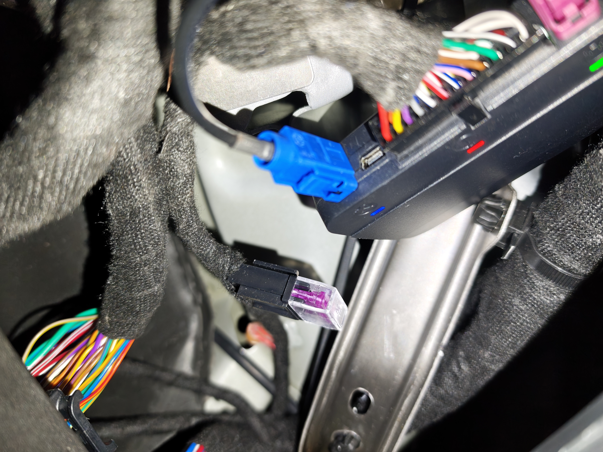
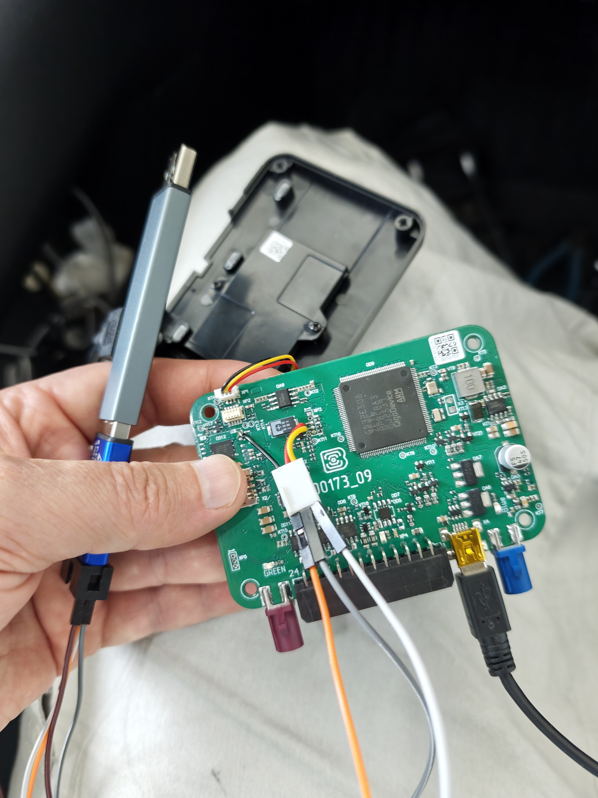
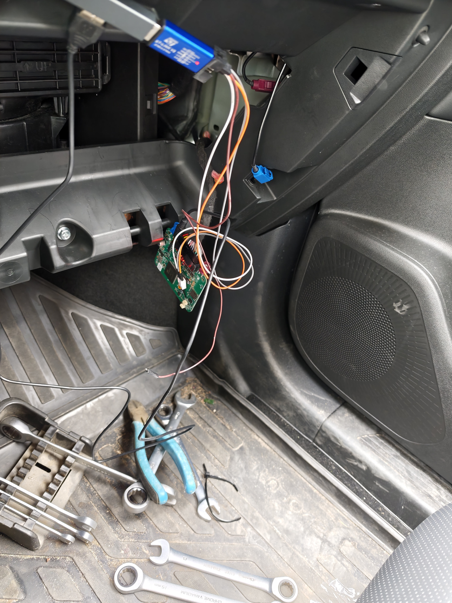

# Vega в Evolute i-Space: зачем она нужна и что можно получить сверх штатного приложения

Vega MT X CAN — телематический блок, через который в исследованном Evolute i-Space работает связь автомобиля с облаком Evassist и мобильным приложением Evolute. Он получает данные автомобиля по CAN, определяет координаты и передаёт информацию через собственный сотовый модем. В обратную сторону приходят команды: управление замками, климатом и другими предусмотренными функциями.

Для штатной работы подключение Vega к головному устройству по USB не требуется. У блока есть собственный канал связи, поэтому удалённая телематика не зависит от Wi-Fi и работающего экрана ГУ.

За время исследований я разобрал часть протокола Vega, настройки, CAN-последовательности и обмен с облаком. На моей машине Vega постоянно подключена к ГУ по USB. Это дало дополнительный локальный доступ к данным и стало основой нескольких проектов.



## Как устроена моя схема

Используются три компонента:

1. **Локальный сервис на ГУ — USB-мост к Vega.** Он позволяет обращаться к блоку из головного устройства, читать телеметрию и исследовать CAN-обмен.
2. **MITM-сервер в дата-центре.** Vega подключается к нему через мобильный интернет, а он перенаправляет обмен на соответствующие серверы Evassist и записывает трафик для исследования.
3. **Vega-интеграция для Home Assistant.** Получает телеметрию и позволяет отправлять команды без API приложения Evolute. В текущей схеме она работает через MITM-сервер.

```text
Vega ── USB ── ГУ: локальный доступ и мониторинг
  │
  └── мобильный интернет ── MITM в дата-центре
                              ├── облако Evassist ── приложение Evolute
                              └── Home Assistant: датчики и управление
```

При недоступности Home Assistant связь MITM с облаком продолжает работать. Подключения к облачным серверам и HA восстанавливаются независимо. При этом управление через собственную интеграцию всё равно требует связи с трекером: независимость от Evassist не означает работу без интернета.

## Четыре серверных подключения и восемь CAN-скриптов

В исследованной конфигурации Vega есть четыре серверных слота. В каждом задаются адрес, порт и протокол. Это отдельные подключения, которые могут использоваться одновременно.

Также есть восемь слотов CAN-скриптов. Скрипт хранит последовательность CAN-кадров с параметрами отправки. В исходной конфигурации моего блока они распределены так:

| Слот | Назначение |
|---|---|
| 0 | Постановка в охрану |
| 1 | Снятие с охраны |
| 2 | Охлаждение |
| 3 | Климат «22 auto» |
| 4 | Прогрев |
| 5 | Открытие багажника |
| 6 | Закрытие багажника |
| 7 | Звуковой сигнал |

Это раскладка конкретного профиля автомобиля, а не универсальная таблица для всех Vega.

Два слота багажника я перепрофилировал под свои эксперименты: сейчас в них записаны `RemoteOn` и `RemoteOff`. Содержимое слотов можно заменять собственными CAN-последовательностями в пределах поддерживаемого формата. Название скрипта само по себе не подтверждает результат: например, текущий `RemoteOn` повторяет последовательность прогрева.

Команда приложения не обязательно напрямую запускает слот с таким же номером. В управлении участвуют и сценарии Vega, связывающие изменение виртуального выхода с запуском CAN-скрипта.

## Подключение по mini-USB: как и зачем

USB даёт прямой доступ к блоку для диагностики, просмотра показаний и настройки. Для исследований он также позволяет записывать CAN-трафик. Разъём **mini-USB** указан в [характеристиках Vega MT X LTE у производителя](https://fmsvega.com/product/mtxlte); встречающееся в ранних заметках обозначение micro-USB нужно исправить.



Для подключения к компьютеру:

1. Подключить кабель с передачей данных к mini-USB блока и USB-порту компьютера. Штатное питание установленного блока оставить подключённым.
2. Установить официальный **Vega MT Configurator** и при необходимости драйвер USB/COM-порта.
3. В конфигураторе выбрать подключение через USB и пройти авторизацию паролем устройства.
4. Перед изменениями сохранить исходные настройки нужных разделов. Сохранённый файл следует проверить: в исследованной версии конфигуратора он не всегда включал все разделы автоматически.

Официальный конфигуратор позволяет просматривать состояние блока, менять настройки, выполнять диагностику и работать с прошивкой. Ссылки на ПО и документацию доступны у [производителя](https://fmsvega.com/en/soft/configmt).

Для постоянного подключения к ГУ кабель прокладывается от Vega до USB-порта головного устройства. На исследованном F515 блок определяется как последовательное USB-устройство. Дальше доступ обеспечивает локальный сервис или F515 Monitor. Одновременно занимать один USB-интерфейс несколькими программами не следует.

## F515 Monitor и Home Assistant

Из первоначального приложения для Vega вырос **F515 Monitor**. Теперь у него два отдельных источника данных:

- **Vega USB** — показания подключённого трекера;
- **VHAL** — данные, доступные через автомобильный интерфейс Android на ГУ.

Поэтому часть возможностей доступна и без USB-подключения Vega. F515 Monitor может передавать показания с ГУ по Wi-Fi в Home Assistant через MQTT Discovery, а также предоставлять HTTP API для чтения телеметрии по локальной сети.

Для MQTT нужен брокер и встроенная MQTT-интеграция Home Assistant. Устанавливать Vega-интеграцию для этого способа не требуется. Доступные показания зависят от прошивки ГУ и конфигурации трекера.

Это два разных пути: F515 Monitor передаёт данные **с работающего ГУ**, а [Vega-интеграция](https://github.com/dsultanr/vega-ha-integration) работает **через сотовое соединение самого трекера**.

## Пароль доступа

В обсуждениях встречаются пароль `1234` и версии о зависимости пароля от VIN или даты выпуска. Подтверждённого универсального правила для наших автомобилей у меня нет.

На моей Vega установлен сложный пароль, который удалось извлечь с помощью программатора. Публиковать его я не буду: нельзя исключить повторное использование на других блоках, хотя одинаковый пароль на всех Vega не подтверждён.



Пароль доступа к устройству и параметры авторизации на серверах — разные вещи. Также нет достаточных оснований связывать истории о самопроизвольном открытии багажников именно с использованием `1234`.

## Что выяснилось про SIM-карту

На исследованной штатной SIM передача данных работает. Попытки отправить SMS и выполнить USSD-запросы завершались ошибками как в LTE, так и после переключения в 2G.

Это согласуется с предположением об ограничениях M2M-подключения, но пока не доказывает, что оператор отключил SMS и USSD. Входящие SMS отдельно не проверены. Поэтому практическая схема удалённого доступа сейчас построена на интернет-соединении трекера.

## Материалы исследований

- [Как Vega обменивается телеметрией и командами с Evassist](https://github.com/dsultanr/f515-lab/blob/master/VEGA_CLOUD_CONTROL_TELEMETRY.md).
- [Разбор подготовки к поездке: API, команды и история датчиков](https://github.com/dsultanr/f515-lab/blob/master/VEGA_TRIP_PREPARATION_2026-11-11.md).
- [Интеграция Vega для Home Assistant](https://github.com/dsultanr/vega-ha-integration).
- [F515 Monitor](https://lab.dsr.su/#vega-monitor).

[Другие фото](https://cloud.mail.ru/public/Fkzv/8d51PdKtF)
