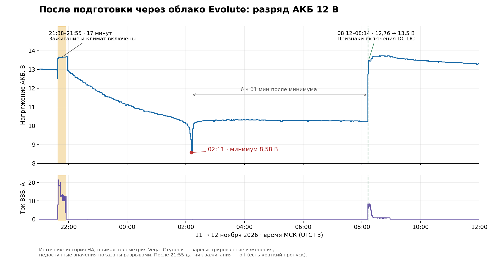

# Evolute: подготовка к поездке — API, MITM и история датчиков

Дата эксперимента: **11 ноября 2026 года**. Автомобиль: Seres / Evolute i-Space 4WD с трекером Vega MT X CAN. Все времена ниже — **МСК (UTC+3)**, если явно не указано другое.

Обновлено **14 ноября 2026 года**: добавлены последствия ночного разряда АКБ и график. Первоначальный вывод о завершении подготовки через 17 минут уточнён.

## Результат

Запуск «Подготовки к поездке» из облака Evolute приводит к двум командам на трекер:

1. Запись `Setting 1341 / sub 0 = 1` (Remote ON).
2. Примерно через шесть секунд — `CMD_COMMAND / subcmd 0x43`, аргумент `03`: запуск CAN-скрипта слота 3.

Слот 3 прочитан с живого трекера: **`22 auto`**. История датчиков подтверждает нагрев салона с 6–7 до 19 °C и расход энергии тяговой батареи. Несмотря на заданные **120 минут**, примерно через **17 минут** выключились датчик зажигания и вентилятор, а ток тяговой батареи стал нулевым. **Это не означало возврата автомобиля в нормальное состояние:** после этого АКБ 12 В продолжил разряжаться, и ночью в истории зарегистрировано **8,58 В**. Признаки включения DC-DC появились только примерно через шесть часов после минимума. В первоначально просмотренном захвате нет команды остановки от облака или управляющей записи от HA. Причина отключения климата и последующего разряда пока не установлена.

## Что проверялось

- Код Android-приложения **Evolute 5.1.27**: Hermes bytecode и таблица строк.
- JavaScript веб-клиента `app.evassist.ru`.
- Живые ответы API карточки автомобиля и телеметрии.
- Сырой TCP-захват MITM на cloudru: трафик облако → трекер и трекер → облако.
- Чтение CAN-скриптов через HA → cloudru → трекер.
- Первоначальная история HA за 21:30–22:05, доступная на момент выгрузки примерно до 22:02:41: прямые датчики Vega и датчики интеграции Evolute.
- При обновлении 14 ноября — история HA за ночь 11–12 ноября и утро 12 ноября; для графика взят интервал 21:00–12:00.
- Сообщение владельца о последствиях эксперимента и установленном ранее LTO-аккумуляторе.

Запуск был выполнен один раз по поручению владельца. Во время наблюдения не отправлялись команды отмены, повторного запуска или изменения конфигурации. Чтение CAN-скриптов создавало дополнительные запросы HA; они отделены от команд облака по направлению `ha2t` / `c2t`.

## Длительность и запуск в API

### Настройка длительности

Карточка автомобиля читается запросом:

```http
GET /car-service/car/v2/{carId}
```

На момент проверки:

```json
{
  "availableScriptTime": [5, 15, 30, 60, 90, 120],
  "currentScriptTime": 120
}
```

Код мобильного приложения меняет длительность отдельно от запуска:

```http
PUT /car-service/car/v2/{carId}
Content-Type: application/json

{"currentScriptTime": 30}
```

Единица — минуты. UI предлагает значения из `availableScriptTime`; проверка `canSetVehicleTripPreparationDuration` отвергает ноль и значения вне списка. Текст приложения сообщает, что настройка применяется ко всем запускам и расписаниям, включая ранее созданные. Изменение длительности в этом эксперименте **не выполнялось**.

### Запуск и отмена

Названия команд получены из живого ответа:

```http
GET /client-bff-service/telemetry/{imei}
```

Кнопка с `tag: "trip-preparation"` содержит:

```json
{
  "activateCommand": "tripPreparationOn",
  "deactivateCommand": "tripPreparationOff",
  "enabled": true
}
```

Отправленный запрос:

```http
POST /client-bff-service/telemetry-commands
Content-Type: application/json

{
  "commandName": "tripPreparationOn",
  "imei": "<IMEI автомобиля>",
  "durationMinutes": 120
}
```

API ответил `201` и вернул `commandId`. Состояние этого же запроса сначала было `scheduled` с `scheduleId`, затем стало `success`; при исполнении поле `userId` имело значение `schedule`. Таким образом, в наблюдавшемся запуске участвовал планировщик облака.

Отмена по коду клиента отправляется в тот же endpoint:

```json
{"commandName": "tripPreparationOff", "imei": "<IMEI автомобиля>"}
```

Она в эксперименте **не отправлялась**. `heatingOn`, `coolingOn` и `tripPreparationOn` — разные команды API. Старый маршрут `/car-service/tbox/v1/{vehicleId}/{commandName}` также присутствует в приложении, но не использовался для этого запуска.

## Что пришло через MITM

Все четыре серверных слота трекера направлены на cloudru. В момент запуска рабочая облачная сессия управления была на **S4**, upstream `telemetry.evassist.ru:21124`. S1/S2/S3 испытывали проблемы соединения и повторяли подключения с задержками. S4 в момент отключения зажигания и вентилятора не разрывался.

| Время МСК | Направление | Событие |
|---|---|---|
| 21:37:25 | Клиент → API | Запрос подготовки на 120 минут |
| 21:38:00.040 | Облако → трекер, S4 | Запись `1341 / 0 = 1` |
| 21:38:00.918 | Трекер → MITM | Ответ на первую команду |
| 21:38:05.932 | Облако → трекер, S4 | Запуск скрипта слота 3 |
| 21:38:06.277 | Трекер → MITM | Ответ на вторую команду |
| 21:38:15.029 | Метаданные облака | `lastRun.startedAt` |
| 21:55:15.009 | Метаданные облака | Расчётный конец: `startedAt + durationMs` |

Полезная нагрузка первой команды, без внешнего заголовка и CRC:

```text
1d000000 02 06 3d05 0000 01 01
│        │  │  │    │    │  └─ значение 1
│        │  │  │    │    └──── длина значения: 1 байт
│        │  │  │    └───────── sub = 0
│        │  │  └────────────── setting = 0x053D = 1341, LE
│        │  └──────────────── длина тела подкоманды: 6
│        └─────────────────── subcmd 0x02: Set Setting
└──────────────────────────── request ID = 29
```

Вторая команда:

```text
1e000000 43 01 03
│        │  │  └─ номер CAN-скрипта: 3
│        │  └──── длина параметра: 1
│        └─────── subcmd 0x43: запуск CAN-скрипта
└──────────────── request ID = 30
```

Обе команды находятся внутри `CMD_COMMAND = 0x01`. Ответы — `CMD_COMMAND_ANS = 0x02`. MITM заменяет request ID для предотвращения пересечений с запросами HA, поэтому ID в сырых ответах трекера отличаются от исходных облачных. Пустой ответ нельзя сам по себе трактовать как доказательство физического выполнения CAN-действия; в этом опыте действие подтверждается также изменениями датчиков.

**Параметра длительности в двух командах запуска нет.** Не обнаружены дополнительные записи таймера или команда `1341=0` около отключения зажигания и вентилятора в 21:55. Это не доказывает отсутствие ранее настроенных таймеров внутри трекера или автомобиля.

## Прочитанный CAN-скрипт

`Setting 5502 / sub 3`, чтение **21:39:03**, имя `22 auto`, `repeat = 1`:

| Шаг | Поле задержки, мс | Поле bus | CAN ID | Данные |
|---|---:|---:|---|---|
| 1 | 2000 | 2 | `0x093` | `24 C3 CC C0 00 0C 00 00` |
| 2 | 8 | 2 | `0x394` | `7C FF 0F FF 00 1F 50 00` |
| 3 | 21 | 2 | `0x011` | `00 58 0A 00 00 00 00 00` |
| 4 | 5 | 1 | `0x011` | `00 00 09 00 00 00 00 00` |

Это содержимое сохранённого скрипта, прочитанное из трекера. Отдельный физический CAN-захват его исполнения в этом эксперименте не проводился. Имена и ранее исследованная последовательность соответствуют климату 22 °C Auto; интерпретация каждого отдельного бита не проверялась заново.

## История датчиков

В таблице использовано время регистрации изменений в HA. Оно может отставать от события на автомобиле; интеграция Evolute дополнительно опрашивает облако, поэтому её переходы позже прямой телеметрии Vega.

| Время МСК | Наблюдение |
|---|---|
| До запуска | Скорость 0, передача P, вентилятор 0, датчик зажигания off, SOC 72%, 12-вольтовая сеть около 13,0 В |
| 21:38:02–06 | Обновились температуры: салон 6–7 °C, улица 2 °C. Датчик зажигания стал on. Напряжение 12 В кратко снизилось до 12,5 В, затем поднялось до 13,59 В |
| 21:38:49 | Пиковые показания: ток тяговой батареи 21,5 А, напряжение 361,0 В, мощность 7,761 кВт |
| 21:41:06 | Вентилятор достиг ступени 7; салон прогрелся до 9 °C, затем до 10 °C |
| 21:43–47 | Вентилятор снизился до 6, затем 5; салон прогрелся до 14–17 °C. Потребление снизилось примерно с 6,5 до 4,5 кВт |
| 21:50–54 | Салон достиг 18–19 °C. Потребление преимущественно около 3,4–4,8 кВт, с кратким снижением до 1,3 кВт |
| **21:55:11** | **Датчик зажигания стал off, вентилятор — 0, ток тяговой батареи — 0 А, расчётная мощность — 0 кВт** |
| 21:55:12–58 | Температура салона снизилась с 19 до 18–17 °C |
| 21:58:11 | Напряжение 12 В снизилось до 12,94 В; к 22:01:32 — до 12,85 В |

### Итоги первых 17 минут

- SOC: **72 → 66%**, снижение на 6 процентных пунктов.
- Оценка энергии по истории датчика мощности: **около 1,36 кВт·ч**. Расчёт — сумма `P × Δt` между изменениями состояния с удержанием предыдущего значения; это оценка по дискретной телеметрии, не отдельный счётчик энергии и не расход только отопителя.
- Салон: **6–7 → 19 °C** при уставке **22 °C**. Уставка не менялась; до неё салон по показаниям датчика не дошёл.
- Температура тяговой батареи: после обновления на старте **6 → 7 °C**. Температура охлаждающей жидкости также **6 → 7 °C**. Эти изменения сами по себе не доказывают включение отдельного подогрева батареи.
- Скорость оставалась 0, передача — P. Открытия дверей и багажника в истории не было. Датчик центрального замка не менялся; его raw-состояние `off` без дополнительной проверки полярности не трактуется как «закрыт» или «открыт».
- Зарядный разъём и зарядка оставались off. Трекер оставался online.
- Показания подогрева передних сидений оставались 0. Неинтерпретированное значение подогрева руля не используется для вывода о его работе.

До пробуждения датчик салона показывал 21 °C, после него сразу 6–7 °C. Это согласуется с обновлением ранее сохранённого значения; считать такой переход мгновенным охлаждением салона нельзя.

### Сопоставление с облаком

После отключения зажигания и вентилятора API сообщил:

```json
{
  "startedAt": 1794422295029,
  "durationMs": 1019980,
  "isActive": false,
  "plannedDurationMs": 7200000
}
```

Фактически учтено **16 минут 59,980 секунды**, план — 120 минут. Прямая телеметрия фиксирует отключение в 21:55:11, а расчётный конец по облачным метаданным — 21:55:15. Расхождение в несколько секунд совместимо с задержкой обработки. Отключение зажигания и вентилятора подтверждается несколькими показаниями, поэтому оно не сводится к смене флага `isActive`. Однако ни эти показания, ни `isActive: false` не подтверждают снятие всей нагрузки с АКБ 12 В или переход автомобиля в сон.

## Что произошло после первых 17 минут

Первоначальный разбор заканчивался наблюдением примерно в 22:02. По этому короткому окну отключение зажигания, вентилятора и тока тяговой батареи было ошибочно принято за завершение подготовки в целом. Ночная история показывает, что состояние автомобиля после этого не вернулось в норму.

По сообщению владельца, подготовка фактически продолжилась уже с выключенным зажиганием и привела к глубокому разряду АКБ 12 В. Ниже приведены измеренные последствия. Какие именно потребители оставались включены и сохранялся ли Remote ON, по имеющимся данным не установлено; непрерывную работу отопителя после 21:55 история не подтверждает.



На графике — зарегистрированные в HA изменения прямых датчиков Vega. Между изменениями удерживается предыдущее значение; состояния `unavailable` показаны разрывами. Это история телеметрии, а не непрерывная осциллограмма. Жёлтым отмечены первые 17 минут с включённым датчиком зажигания. Нижняя панель показывает ток **тяговой батареи**, а не ток АКБ 12 В.

| Время МСК | Что видно в истории |
|---|---|
| 11 ноября, 21:38–21:55 | Первоначальный прогрев: напряжение 12-вольтовой сети около 13,6 В, зажигание включено, климат работает |
| 11 ноября, 21:55:11 | Зажигание off, вентилятор 0, ток тяговой батареи 0 А; затем начинается длительное снижение напряжения АКБ 12 В |
| 11 ноября, 22:01:32 | 12,85 В — последние минуты, рассмотренные в первоначальном разборе |
| 12 ноября, 00:05:56 | Напряжение уже 11,06 В |
| **12 ноября, 02:11:20** | **Минимум в доступной истории: 8,58 В**. Такой же минимум зарегистрирован интеграцией Evolute |
| 12 ноября, 02:18–08:12 | Напряжение восстанавливается примерно до 10,2–10,3 В и остаётся на этом уровне; возврата к уровню зарядки ещё нет |
| **12 ноября, 08:12:17–08:13:53** | **Напряжение поднимается до 12,76 В, затем до 13,5 В**. В 08:12:18 ток тяговой батареи становится 8,3 А; датчик зажигания остаётся off |

Между зарегистрированным минимумом и подъёмом напряжения в 08:12 прошло **6 часов 1 минута**. От отключения зажигания в 21:55 до этого подъёма — **10 часов 17 минут**. Эти интервалы важно различать: шесть часов отсчитываются от провала напряжения, а не от запуска подготовки.

Рост напряжения 12-вольтовой сети одновременно с появлением тока тяговой батареи согласуется с включением **DC-DC и подзарядкой АКБ**. Отдельного сигнала состояния DC-DC в этой выборке нет, поэтому это интерпретация сочетания показаний. Подъём с 8,58 до примерно 10,3 В сразу после минимума сам по себе ещё не доказывает зарядку.

В сообщении владельца разряд описан как «до 8 вольт»; точный минимум доступной истории HA — **8,58 В**. Более низкое напряжение между зарегистрированными точками этими данными ни подтверждается, ни исключается. Датчики Vega и Evolute получают данные одного автомобиля и не являются двумя независимыми вольтметрами.

По словам владельца, штатный АКБ ранее был заменён на **LTO**, который пережил этот разряд. Это результат конкретного случая, а не подтверждение допустимости такого режима для аккумулятора.

## Выводы и ограничения

**Подтверждено:** облако активировало Remote и запустило слот 3; автомобиль потреблял энергию и грел салон; примерно через 17 минут выключились датчик зажигания и вентилятор, ток тяговой батареи стал нулевым. Облачной команды остановки и управляющей записи HA в первоначально просмотренном захвате нет. В момент этого перехода S4 и поступление телеметрии продолжали работать.

**Уточнение по последствиям:** остановка видимого прогрева и `isActive: false` не означали нормального завершения всего процесса. После них произошёл длительный разряд АКБ 12 В до зарегистрированных 8,58 В. Признаки подзарядки от DC-DC появились лишь утром, примерно через шесть часов после минимума. Поэтому прежний вывод «подготовка завершилась через 17 минут» следует читать только как длительность первоначальной фазы прогрева, а не как подтверждение возврата автомобиля в штатное состояние.

**Не установлено:** почему климат отключился раньше 120 минут, какая нагрузка затем разряжала АКБ и что вызвало утреннее включение DC-DC. Возможны локальные условия, таймеры автомобиля, сценарии трекера или другие воздействия. Имеющиеся данные не позволяют выбрать конкретную причину или доказать непрерывное выполнение CAN-скрипта всю ночь. Достижение температурной уставки не подтверждается: в первоначальной фазе салон прогрелся максимум до 19 °C при заданных 22 °C. Отсутствие команды остановки установлено для первоначально просмотренного захвата; на всю ночь этот вывод без дополнительного разбора трафика не распространяется.

Для выяснения причины нужно сопоставить ночной трафик со сценариями и таймерами трекера, состоянием Remote и потребителями 12-вольтовой сети. В рамках этого обновления выполнено только чтение истории: новые запуски подготовки и изменения конфигурации не проводились.

## Воспроизводимость

Локальные исходные материалы сохранены в `~/vega/preparation-mitm-20261111/`:

- `start.json`, `launch.json` — отправленный запрос и ответ;
- `observations.jsonl`, `status.json`, `watch-finished.json` — наблюдение API;
- `commands-current.jsonl`, `commands-all.jsonl` — декодированные команды, включая отдельную проверку запросов HA;
- `rawcap/` — локальный снимок сырых потоков, сделанный в начале опыта; полный последующий поток хранится в основном архиве MITM;
- `script-state.json` — прочитанные CAN-скрипты;
- `history.json`, `entities.json` — выгрузка истории и перечень сущностей HA.

Код приложения и результаты разбора API находятся в `~/vega/evolute-rustore-20261110/`. Сырые материалы с идентификаторами автомобиля и возможными данными авторизации не включены в этот документ. API-примеры используют placeholders; команды в них не предназначены для автоматического исполнения.

### Данные ночного разряда и построение графика

В репозиторий включена [обезличенная выгрузка изменений датчиков](datasets/vega-preparation/2026-11-11/telemetry.csv): напряжение АКБ 12 В, ток тяговой батареи, зажигание и ступень вентилятора. Время в CSV — UTC; на графике и в тексте — МСК. Числовые значения округлены до двух десятичных знаков. Первая строка каждого датчика на границе окна задаёт начальное состояние, а не обязательно новое событие автомобиля.

[Скрипт построения](datasets/vega-preparation/2026-11-11/plot.py) создаёт PNG и SVG из CSV; требуется `matplotlib`:

```sh
python3 datasets/vega-preparation/2026-11-11/plot.py
```

Полная локальная выгрузка для проверки сохранена в `~/vega/preparation-mitm-20261111/history-aftermath.json` и в публичный набор не включена.
