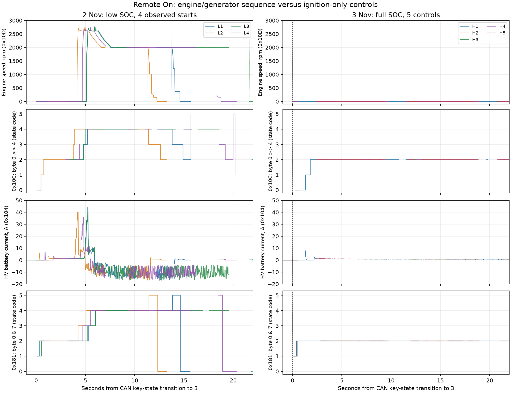

# Запуск ДВС: сравнение CAN при 11% и 100% заряда ВВБ

Сравнение записей от 2 и 3 ноября 2026 года, Evolute i-Space 4WD / F515.
При низком заряде Remote On через Vega сопровождался запуском ДВС;
при полном заряде двигатель оставался выключенным. Климат был выключен.
Зарядный кабель перед контрольным сеансом отключён.

**Повторяемые признаки запуска найдены. Подтверждённая CAN-команда
принудительного запуска пока не установлена.**

В анализ вошли четыре записанных фронта запуска при низком заряде
и пять контрольных Remote On при полном. Начало первой записи с уже
работающим двигателем не считается отдельным пуском. Ещё одна команда
Remote On не дала подтверждённого пуска; отсутствие кадров оборотов
в этом окне не подменялось нулевыми оборотами.

| Поле CAN, шина 0 | Наблюдение | Оценка |
| --- | --- | --- |
| `0x10C`, `data[0] >> 4` | `2 → 3 → 4` в четырёх пусках; при полном заряде коды 3/4 отсутствуют | Кандидат на состояния генераторного блока, ориентир для дальнейшего поиска |
| `0x181`, `data[0] & 7` | `2 → 3 → 4` при пусках; в контроле остаётся 2 | Вероятная обратная связь о состоянии двигателя |
| `0x181`, `data[1] & 0x10` | Установлен после включения зажигания при низком заряде, сброшен в контроле | Значение неизвестно; возможна зависимость от заряда или температуры |

Байты нумеруются с нуля. Первый записанный код 3 в `0x10C` опережает
первые записанные обороты выше 100 об/мин на **0,318–0,374 секунды**.
Это временная связь в записях, а не доказательство управляющей команды
или измерение момента первого физического движения коленвала.
С учётом интервалов между соседними кадрами границы опережения — 0,299–0,722 с.

## Материалы

- [Полный отчёт: кандидаты, отвергнутые гипотезы и ограничения](REPORT.ru.txt)
- [Архив анализа: отчёт, графики, таблицы и скрипты](vega-remote-engine-comparison-20261103.zip)
- [Как воспроизвести анализ](REPRODUCE.txt)
- [График PNG](comparison.png) · [SVG](comparison.svg)
- [Сводка циклов](cycles.csv) · [Подробные результаты](findings.json)
- [Проверка исходных пакетов](verification.json) · [48 опорных кадров с байтовыми смещениями](evidence-records.csv)
- [Контрольные суммы файлов каталога](SHA256SUMS)

## Исходные записи

| Сеанс | Условия | Кадры | Скачать |
| --- | --- | ---: | --- |
| [02.11.2026](../2026-11-02/README.txt) | 11% по индикации владельца; в CAN 11,8–12,0%; ДВС запускался | 632 580 | [ZIP](../2026-11-02/vega-can-research-20261102.zip) |
| [03.11.2026](../2026-11-03/README.md) | 100%; пять контрольных Remote On без запуска ДВС | 1 563 506 | [ZIP](../2026-11-03/vega-can-research-20261103.zip) |

В архивах — исходный BIN, CSV, candump, декодер, метки команд
и телеметрия Home Assistant, включая HV Battery Current.
Содержимое исходных архивов при публикации сравнения не менялось.

## Ограничения и дальнейшая проверка

В записях есть паузы приёма до 2,160 и 2,188 секунды; короткие переходы
могли не попасть в файл. Все 87 119 сохранённых CAN-пакетов проверены по CRC.
Один автомобиль и два разных уровня заряда не позволяют отделить влияние
пуска от заряда, температуры и прочих условий. Экспериментальные CAN-кадры
при анализе не отправлялись.

Следующее полезное сравнение — пассивно записать штатное включение и
выключение подзарядки ДВС при уже включённом зажигании и близком заряде,
если такая функция доступна. Оно поможет отделить запрос подзарядки от
пробуждения блоков при Remote On. Текущие результаты не подтверждают,
что повторная передача найденных кадров запустит двигатель.
